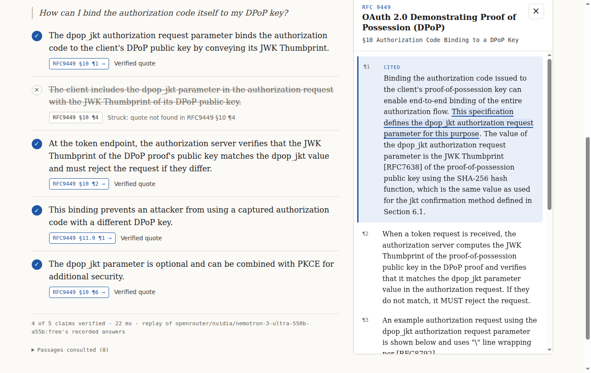

# Citebound

An RFC assistant that checks every quotation against pinned RFC text.

Ask a question about OAuth 2.0, JOSE and JWT, or HTTP. Every claim in the
answer cites one paragraph of a pinned RFC and quotes it word for word. Code,
not a model, checks that each quote really is in the paragraph it cites.
Claims that fail are struck out, and if nothing survives, Citebound says the
corpus does not support an answer.

The check proves a quote is real, not that it supports the claim beside it: a
true quote can sit next to a false claim and still pass. See
[what verification proves](docs/answer-format.md#what-verification-proves)
and [the limitations](docs/limitations.md), each pinned by a test.

Try it with no API key. Requires Go 1.26 or later, and Node.js 24 for the web
tests.

```sh
make demo   # four answers: a real model's, a refusal, a struck fake quote, and a false claim that passes
make test   # Go and web tests
```

```console
$ citebound ask -model openrouter/nvidia/nemotron-3-ultra-550b-a55b:free \
    -replay evals/recordings/nemotron-3-ultra.jsonl "Can a refresh token be bound to a client?"
✓ Refresh tokens are bound to the client to which they were issued.
  RFC6749 §6 ¶5

✓ The OAuth 2.0 framework requires authorization servers to bind refresh tokens to the client.
  RFC8705 §7.1 ¶1

✓ Refresh tokens are secrets bound to the client identifier and client instance.
  RFC6819 §3.3 ¶3

$ citebound check examples/fabricated-quote.txt
✓ Authorization codes must expire soon after they are issued.
  RFC6749 §4.1.2 ¶2

✗ Authorization codes must expire within 60 seconds.
  struck: quote-not-found
```

The first answer is a real model's, recorded once and replayed, so it runs
offline. The second is hand-written: no model in the recordings has yet
invented a quote, so the demo shows the check on a made-up one.



The web UI streams each claim as it is checked. Click a verified citation to
open the RFC paragraph with the quote highlighted. The struck claim above is a
false strike: the model quoted a figure correctly but escaped it as JSON (see
[the limitations](docs/limitations.md#a-real-quote-can-be-struck-because-the-model-escaped-it)).
To run this page with no API key:

```sh
make build
bin/citebound serve -model openrouter/nvidia/nemotron-3-ultra-550b-a55b:free \
  -replay evals/recordings/nemotron-3-ultra.jsonl   # http://127.0.0.1:8080
```

Replay mode answers only the recorded questions, such as the examples under
the question box. Another question ends in an error when search finds passages
for it, because there is no recorded answer to replay. A question that matches
no passages is withheld as usual, since no answer is requested.

To run the web UI with no Go or Node.js, use the container image. It
answers extractively by default; [the container docs](docs/container.md)
show replay and live models.

```sh
podman build -t citebound . && podman run --rm -p 8080:8080 citebound   # or docker
```

> [!NOTE]
> Work in progress toward v0.1.0. See the
> [milestones](https://github.com/rick-learns/citebound/milestones).

## How it works

1. **Corpus.** 21 RFCs, pinned as plain text with SHA-256 checksums, are split
   into sections and paragraphs with stable IDs such as `RFC6749 §10.4 ¶2`.
   See [`corpus/`](corpus/README.md).
2. **Retrieval.** An in-memory SQLite FTS5 index ranks paragraphs with BM25.
3. **Answer.** An answerer writes one claim per line, each ending in a
   citation and a verbatim quote. See [the answer format](docs/answer-format.md).
4. **Verification.** Each quote must appear in the cited paragraph, exactly,
   apart from whitespace and typographic punctuation. Anything else is
   struck, with a reason. See
   [decision 0005](docs/decisions/0005-exact-quote-verification.md).
5. **Abstention.** If no claim verifies, or fewer than half do, the answer is
   withheld. See [decision 0006](docs/decisions/0006-abstention-policy.md).

Verification proves that a quote is real. It does not prove that the quote
supports the claim; that is what the evals measure.

## Evals

The [scorecard](docs/scorecard.md) measures four things separately:
retrieval, quotation validity, claim support, and refusal. CI regenerates it
from the committed [evals](evals/README.md) and recorded answers on every
pull request, and fails if it changed. CI also fails if recall@5 or MRR drops
below the committed baseline, or if a verified claim has no support label.

| Answerer | Quotes verified | Verified claims supported | False refusals | Unanswerable abstained |
| --- | --- | --- | --- | --- |
| Extractive | 106 of 106 | 106 of 106 | 54 of 100 | 17 of 20 |
| Nemotron 3 Ultra | 203 of 206 | 144 of 203 | 14 of 100 | 20 of 20 |

Support labels come from two models, not yet reviewed by a person. Search
scores 0.52 recall@5 and 0.44 MRR@10.

## More commands

```sh
go run ./cmd/citebound ask "Should access tokens be sent in the URI query?"
go run ./cmd/citebound search "DPoP proof nonce"
echo 'Tokens expire. [RFC6749 §1.5 ¶2: "refresh tokens never expire"]' | go run ./cmd/citebound check -
go run ./cmd/citebound corpus stats
go run ./cmd/citebound serve   # HTTP API on 127.0.0.1:8080
make build && bin/citebound serve   # the same, with the web UI at http://127.0.0.1:8080
make eval                      # run every eval; fails on a regression or a stale scorecard
make scorecard                 # regenerate docs/scorecard.md

# A real model's recorded answers, replayed with no API key
go run ./cmd/citebound ask -model openrouter/nvidia/nemotron-3-ultra-550b-a55b:free \
  -replay evals/recordings/nemotron-3-ultra.jsonl "Is the implicit grant still recommended?"
```

## Documentation

- [Answer format](docs/answer-format.md)
- [HTTP API](docs/api.md)
- [Container](docs/container.md)
- [Scorecard](docs/scorecard.md) and [evals](evals/README.md)
- [Limitations](docs/limitations.md)
- [Decision records](docs/decisions/README.md)
- [Corpus and parsing](corpus/README.md)
- [Contributing](CONTRIBUTING.md) and [security policy](SECURITY.md)

## License

Code: see [LICENSE](LICENSE). RFC text: see [`corpus/README.md`](corpus/README.md).
