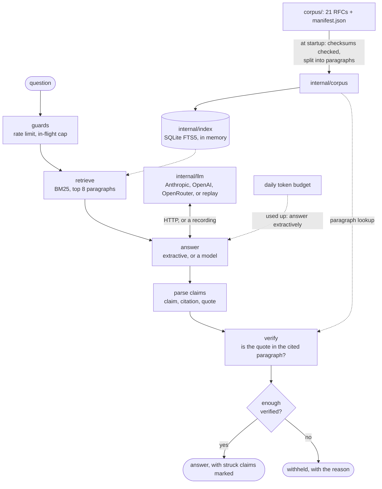

# Architecture

Citebound is one Go binary. It loads a pinned RFC corpus into an in-memory
index at startup, then answers questions through a fixed pipeline: retrieve,
answer, verify, decide. Only the answer step may call a model. Every other
step is deterministic code, and every quote is checked against the corpus
before it is shown as verified.

## Packages

| Package | Role |
| --- | --- |
| [`internal/corpus`](../internal/corpus) | Loads the pinned RFC text, checks each file's SHA-256 against `corpus/manifest.json`, and splits it into sections and paragraphs with stable refs such as `RFC6749 §10.4 ¶2` ([decision 0004](decisions/0004-pinned-rfc-corpus.md)) |
| [`internal/index`](../internal/index) | Builds an in-memory SQLite FTS5 index of the paragraphs at startup and ranks them with BM25, with section titles weighted 3x. Reference lists are not indexed |
| [`internal/answer`](../internal/answer) | The pipeline, and the two answerers: `Extractive`, which quotes sentences from the top passages, and `Model`, which asks a language model for claims in [the answer format](answer-format.md). It also holds the abstention policy ([decision 0006](decisions/0006-abstention-policy.md)) |
| [`internal/llm`](../internal/llm) | Plain HTTP clients for the providers, and request-keyed recordings so model answers replay offline ([decision 0007](decisions/0007-model-providers-and-replay.md)) |
| [`internal/verify`](../internal/verify) | Parses an answer into claims and checks that each quote appears in the paragraph it cites, after narrow normalization ([decisions 0005](decisions/0005-exact-quote-verification.md) and [0008](decisions/0008-escaped-double-quotes.md)). It does not judge whether the quote supports the claim |
| [`internal/server`](../internal/server) | The HTTP API: answers stream as server-sent events, behind per-client rate limits, an in-flight cap, and a daily token budget ([decisions 0010](decisions/0010-rate-limit-and-cap-asks.md) and [0011](decisions/0011-daily-token-budget.md)). See [the API](api.md) |
| [`internal/eval`](../internal/eval) | Scores retrieval, quotation validity, claim support, and refusal, and writes [the scorecard](scorecard.md) |
| [`web`](../web) | The TypeScript UI, with no framework, embedded in the binary when built with the `embedui` tag ([decision 0009](decisions/0009-embed-the-web-ui.md)) |
| [`cmd/citebound`](../cmd/citebound) | The CLI: `ask`, `check`, `search`, `serve`, `eval`, and `corpus` |

## One question, step by step

1. **Guards.** The server checks the request, then the client's rate limit
   and the cap on concurrent asks. A refused request costs no model tokens.
2. **Retrieve.** BM25 returns the top 8 paragraphs. With none, the answer is
   withheld as `no-passages` and no model is called.
3. **Answer.** The answerer writes one claim per line, each with a citation
   and a verbatim quote, or says the passages do not answer the question. A
   model answerer goes through `internal/llm`, which in replay mode reads a
   recording instead of calling the provider. Once the daily token budget is
   used up, the server answers extractively instead.
4. **Verify.** Each claim's quote must appear in the paragraph its citation
   names, looked up in the whole corpus, not only in the retrieved passages.
   Anything else is struck, with a reason such as `quote-not-found` or
   `uncited`.
5. **Decide.** The answer is withheld if the answerer abstained, no claim
   verified, or fewer than half did. Withheld answers still list their claims
   and verdicts, for transparency.

The server streams each step as it happens: a `retrieval` event, then a
`claim` and a `verdict` for each claim, an `abstain` event if the answer was
withheld, and a final `done` event with counts, latency, and token use.

## What runs offline

Everything except a live model call. The corpus is committed and pinned by
checksum, the index is rebuilt in memory at startup, and recorded model
answers replay with no key and no network. `make demo`, `make test`, the
evals, the scorecard, and the [container image](container.md) all run this
way.
